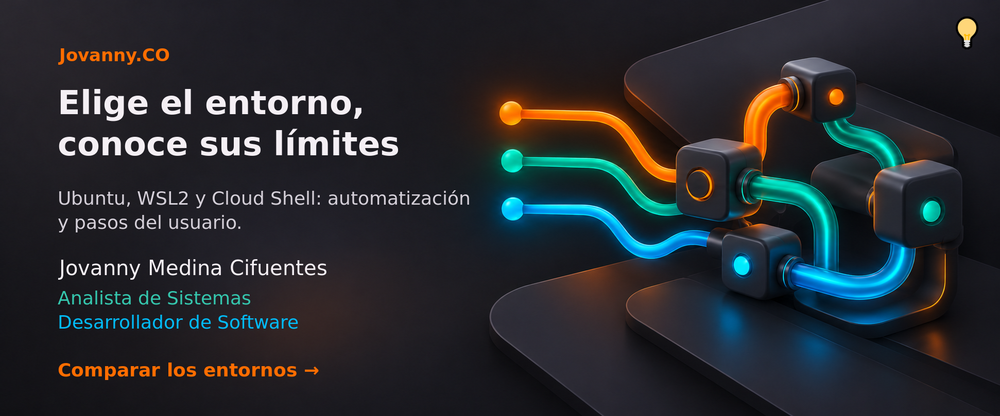

[Comparar los entornos →](#compatibilidad-y-límites-de-automatización)

# Compatibilidad y límites de automatización

[Volver a la portada](../README.md) · [Guía de uso](USO.md)

Terminal Tuning automatiza la configuración de Bash y sus comandos de usuario. La
apariencia de cada emulador y editor también depende de su interfaz.

| Entorno | Se automatiza | Paso del usuario | Estado de validación |
|---|---|---|---|
| Ubuntu 26.04 sobre WSL2 | Prompt Bash, atajos, comandos, preferencias y respaldos | Fuente y perfil en Windows Terminal; configuración de WSL | Instalación en el equipo de referencia y pruebas aisladas; distribución nueva pendiente |
| Ubuntu 26.04 | Los mismos componentes; extras opcionales desde APT | Elegir fuente y colores en el emulador | Pruebas del instalador; revisión visual del emulador pendiente |
| Google Cloud Shell x86_64 | Inicialización de Google, Starship y extras en HOME, variante sin Nerd Font, Bash de respaldo | Tema/fuente disponibles en la interfaz; validación con promptTMP | Fixtures locales y verificación de archivos oficiales; sesión real pendiente |
| Otros sistemas o arquitecturas | Sin soporte declarado | Adaptar y probar antes de instalar | El instalador rechaza sistemas fuera de alcance; los extras Cloud requieren x86_64 |

`--no-packages` aplica archivos y comandos, sin instalar las herramientas
opcionales. `--target-dir` prepara archivos aislados; no activa otra terminal.
Las pruebas no certifican autenticación, claves ni aplicaciones de tus proyectos.

## Google Cloud Shell y su editor

Las configuraciones y los binarios de usuario se guardan en HOME. Google ofrece
5 GB persistentes allí; los cambios fuera de HOME desaparecen al terminar la
VM. El modo efímero no conserva esos archivos. La inicialización de
`/google/devshell/bashrc.google` debe permanecer en `.bashrc`, y Cloud Shell
Editor no permite instalar extensiones propias. Consulta las
[limitaciones oficiales de Cloud Shell](https://docs.cloud.google.com/shell/docs/quotas-limits).

Los extras iniciales están fijados a Starship **1.26.0**, eza **0.23.5** y
fastfetch **2.69.0**, con SHA256 en el script. No se ejecutan instaladores
descargados ni se usa `latest`. Las copias ejecutables existentes en
`~/.local/bin` se conservan, aunque sean de otra versión. Las actualizaciones
de esos valores deben revisar el proveedor, el digest y el funcionamiento del
archivo; `devup` no actualiza estas tres herramientas.

Instalar una fuente en Linux no la registra en el selector del navegador. Usa
las opciones disponibles en **Terminal preferences**. Para el editor, Google
documenta **Settings → Themes → Color Theme** y el ajuste
`workbench.colorTheme`; elige un tema disponible en lugar de intentar instalar
uno con una extensión. [Personalización de Cloud Shell](https://docs.cloud.google.com/shell/docs/configuring-cloud-shell),
[temas del editor](https://docs.cloud.google.com/shell/docs/themes).

El prompt y los listados Cloud evitan glifos Nerd Font; los símbolos Unicode
estándar dependen de la fuente seleccionada. La paleta MD3 incluye terciario
**azul cian `#02BCF9`**. Esto no garantiza que el editor web reproduzca toda la
apariencia de Windows Terminal.

Usa [promptTMP.md](../promptTMP.md) con un agente dentro de Cloud Shell. Ese
procedimiento incluye instalación, reinstalación, comprobaciones funcionales y
una lista breve de revisión visual. Registra las limitaciones observadas.

## Identidad y publicación

Clonar Terminal Tuning por HTTPS no requiere SSH. Instalarlo no configura credenciales
ni firma de otros repositorios. El alias conserva la rama de trabajo de cada
repositorio: `main` para la principal pública de Terminal Tuning y `production` cuando
sea la principal privada configurada por su propietario. `git syncPR` prepara
PR y `git syncPRmerge` exige pruebas locales, criterios y auditoría independiente
para fusionarlos. Consulta [Git sync](USO.md#git-sync).

[Validar Cloud Shell →](../promptTMP.md)
